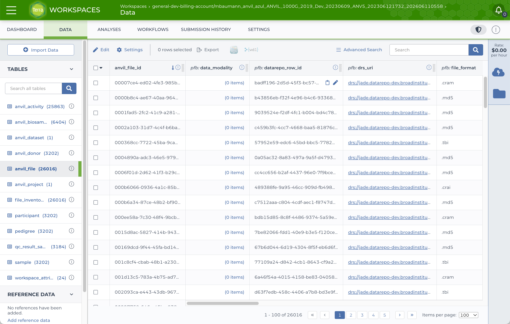

# Terra Workspace Data Tables

# Feature Overview
All Terra Workspaces provide Terra Data Tables. When the workspace is created, zero tables are defined. The tables are created and populated through importing data or interactive editing.
The user interaction style is similar to a Spreadsheet Workbook, with one table per tab (but without support for cell formulas, etc.).

The types of cell values are:  
* Boolean  
* Number  
* String  
* Reference # to a row in another table (aka foreign key)  
* A list of any one of the types above.

The Terra UI for the Terra Data Tables is shown below, for open-access 1,000 Genomes data in the Terra dev tier. Each table has a tab on the left of the screen.

# Technical Overview
Terra Data Tables are based on an Entity, Attribute, Relationship model.  
Terminology includes:  
* EntityType -> table name  
* Entity -> a row in a table  
* Attribute -> a column  
* Reference -> link from a row in one table to a row in a different table  
	

Terra workspace data tables are highly capable and work well for the vast majority of research analyses. There are no fixed limits on a table's number of rows or columns.

Naming and length conventions
* Primary key of data table row (values in the first column): alphanumeric characters, underscores, dashes, and periods. Max 254 characters.
* Data table name: alphanumeric characters, underscores, and dashes. Max 254 characters.
* Data table column names: alphanumeric characters, underscores, dashes, and periods. Max 254 characters.
* Data table column values: dependent on data type:
	* Number values are represented as FLOAT and have a precision limitation of 16 decimals. Numbers with more than 16 decimals are rounded by approximation. For more information see the MySQL Documentation. 
	* String values have a maximum of 65,535 bytes.

Overall Size Guidance  
A table's overall size is based on the number of rows multiplied by the number of columns and the size of the table's values. Tables often contain 200,000+ rows and 100+ columns. As the table size increases well beyond these values, the Terra UI performance and usability may decline, and some operations may not be completed within the allotted timeout.

# Programmatic Access
JSON is the primary format used for reading/writing Terra data tables, and is strongly recommended for this project. TSV import/export is also available, yet is not recommended for this project.

The Terra Rawls backend service provides the most scalability/reliability, and is the best API to use for this project.

This project only involves reading data.

Rawls Entities Endpoints
* GET /api/workspaces/{workspaceNamespace}/{workspaceName}/entities  
Get entity type metadata: for each type, the number of entities of that type and all attribute names used.  
This is the starting point for a comprehensive structural overview of all the data tables in the workspace, and may provide all that is needed for table comparison tiers 1-3.

* GET /api/workspaces/{workspaceNamespace}/{workspaceName}/entities/{entityType}  
List all entities of a given type.  
Provides a way to get all the values for a given entityType/table for comparison tier 4.

* GET /api/workspaces/{workspaceNamespace}/{workspaceName}/entityQuery/{entityType}  
Paginated query for entities in a workspace.  
This be helpful when working with very large tables for table comparison tier 4.
For example, if the table is very large and timeouts occur before the whole table can be read, using this API to read the columns in chunks until the whole table has been processed could be effective.

Use Long Client-Side Timeout Values  
Large tables can take a long time to read. IIRC, Rawls uses a two-minute server-side timeout. I think starting with a 2-3 minute client-side timeout makes sense.
Even this may not be enough for some very large tables, in which case chunking techniques are required to obtain all the data.